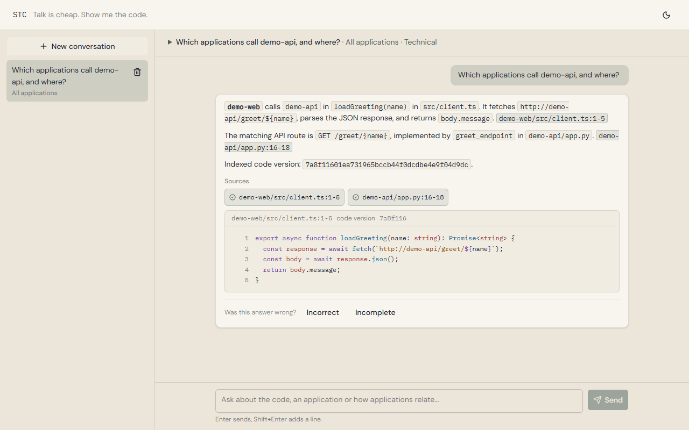
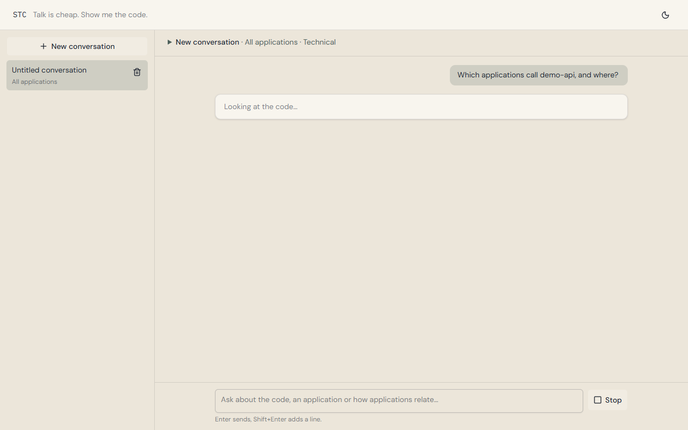
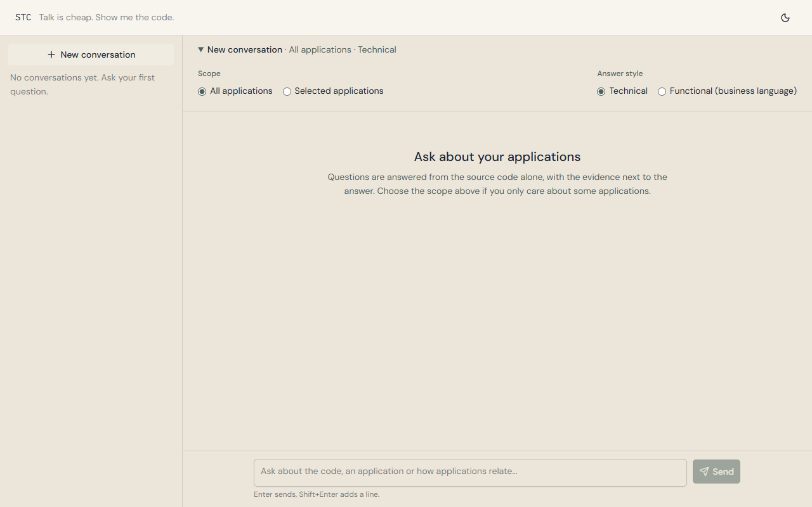
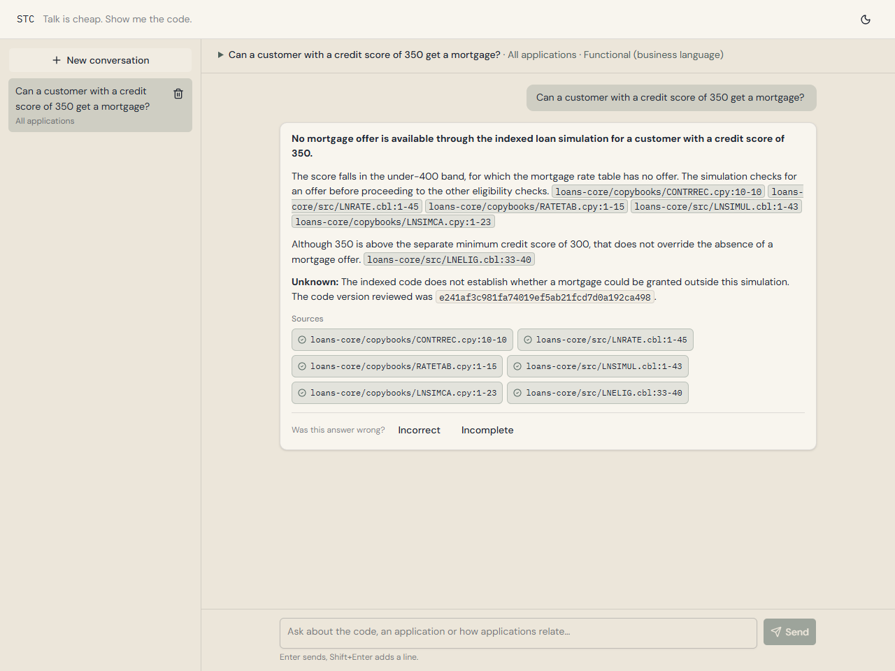
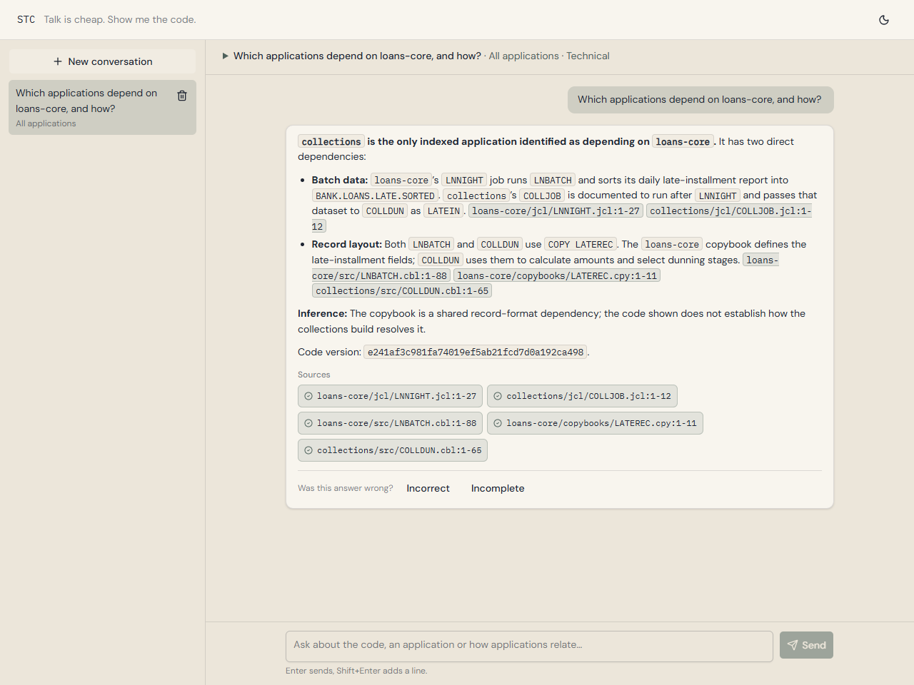
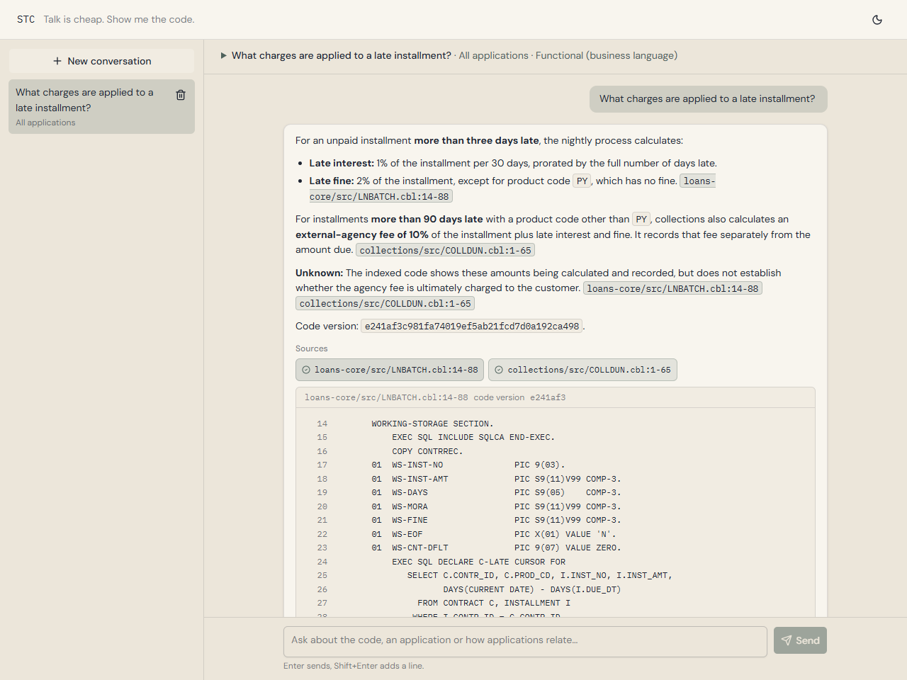

# STC

> *"Talk is cheap. Show me the code."* — Linus Torvalds

STC understands and answers questions about large collections of applications **that have no documentation**, using only their source code. Point it at folders or GitHub repositories with 100+ applications and ask things like *"which applications talk to the billing service?"* or *"where is this field validated?"*. Every answer comes with the evidence that backs it: application, file, line range and indexed code version.

The name is the philosophy: the system does not just talk, it shows the code.

## Status

**Working, pre-1.0** (see the [changelog](CHANGELOG.md)). The whole pipeline runs end to end: sources (local folders and GitHub), indexer, catalogs, global map, query engine, chat (API + web UI), MCP server, evaluation harness and operations commands (`sync`, `reindex`, `status`, Docker Compose). It has been exercised on the demo applications and on small real projects (TypeScript, Java/Spring Boot, React).

Not implemented yet: chat authentication (do not expose the chat beyond a trusted network), GitLab as a source, the Anthropic and Voyage providers (OpenAI is the one available), Gradle/Gemfile manifest detection, and extra sources in the Docker Compose setup (use the `stc` commands on your machine for those). The design is described in [docs/functional-spec.md](docs/functional-spec.md) and may still change.

## How it works

1. **Index.** The indexer walks read-only *sources* (local folders, and the repositories of a GitHub organization or user, which `stc sync` clones shallowly), detects the applications in them, strips secrets (and redacts credential values in configuration files), splits the code into meaningful units (functions, classes, modules) with tree-sitter, extracts signals (endpoints, outgoing calls, databases, messaging) and derives the relations between applications. Uncertain relations can be confirmed by the LLM. Indexing is incremental and idempotent.
2. **Catalog.** For each application it generates a human-readable, editable markdown **catalog** (purpose, stack, data model, endpoints, integrations, main flows, …), where every statement carries verified evidence and a confidence level, and gaps are listed instead of guessed. A **global map** shows how the applications relate to each other. Manual corrections survive regeneration.
3. **Query.** A single query engine searches catalogs and code (semantic + exact + symbol search), follows dependencies and reads files. It is exposed through:
   - a **chat** (web UI) that iterates over the engine until it has enough evidence, streams the answer, verifies every citation against the code and separates what is *proven in the code* from what is *inferred*;
   - an **MCP server**, so tools such as Claude Code, Claude Desktop or Cursor can query the same knowledge;
   - the `stc query` and `stc ask` commands.
4. **Document.** `stc docs` writes the full documentation of an application: linked markdown pages (overview, architecture, one page per feature, data model, interfaces, dependencies, configuration and operations) with Mermaid diagrams, viewable in the web UI under `/docs`. Tables and diagrams come from the index; the narrative is written by the LLM from assembled evidence and every statement is verified against the indexed code. See [Documentation and migration specifications](#documentation-and-migration-specifications).
5. **Specify.** `stc spec` writes, per feature, a migration specification (requirements, business rules, data, proposed design and implementation plan for a configurable target stack, acceptance scenarios, risks), meant for a coding assistant such as Claude Code to implement in a new project. STC does not generate the new code.
6. **Evaluate.** `stc evaluate` runs a file of reference questions and reports search recall and answer quality, so changes to the indexer or the prompts can be measured.

Design principles:

- Facts (applications, symbols, relations, locations) come from deterministic analysis; the LLM interprets and always cites evidence.
- Application code is read-only: it is never modified or executed.
- Secrets are never indexed, sent to external services or returned in answers.
- Bring your own model provider: OpenAI first, Anthropic and others by configuration.

## Screenshots

The chat answering a question about the demo applications in `examples/demo-root/`: every claim carries a citation that was checked against the code, and clicking it shows the cited lines.

<picture>
  <source media="(prefers-color-scheme: dark)" srcset="docs/images/chat-answer-dark.png">
  
</picture>

While it works, the chat shows the steps it takes over the query engine; the scope and the answer style (technical or functional) are chosen per conversation.

<picture>
  <source media="(prefers-color-scheme: dark)" srcset="docs/images/chat-working-dark.png">
  
</picture>

<picture>
  <source media="(prefers-color-scheme: dark)" srcset="docs/images/chat-scope-dark.png">
  
</picture>

### Searching COBOL programs

STC also reads COBOL, copybooks and JCL (no documentation needed). The screenshots below use the fictional bank in `examples/cobol-bank-root/` (a loans application, a collections application and a teller application, with a nightly batch job, copybooks, DB2 tables and terminal screens). Business-rule questions can be answered in business language, with every citation checked against the indexed code.

A functional question: the answer finds the rate table (a copybook) and the program that reads it, and says what the code does not establish.

<picture>
  <source media="(prefers-color-scheme: dark)" srcset="docs/images/cobol-business-rule-dark.png">
  
</picture>

Relations between applications come from the code, not from guesses: the collections application depends on the loans application through a dataset written by one JCL job and read by another, and through a shared copybook.

<picture>
  <source media="(prefers-color-scheme: dark)" srcset="docs/images/cobol-dependencies-dark.png">
  
</picture>

Terminal screens are read too (`SCREEN SECTION`, `ACCEPT`/`DISPLAY ... AT` and CICS BMS maps): the documentation lists each screen with its fields and the navigation between screens, and `stc spec` turns them into forms and an API contract for a new frontend (the sample `teller` application has a transfer screen and a balance map; `examples/stack-spring-angular.txt` describes a Spring Boot and Angular target).

Clicking a citation opens the cited COBOL lines, with the code version they were indexed from.

<picture>
  <source media="(prefers-color-scheme: dark)" srcset="docs/images/cobol-cited-code-dark.png">
  
</picture>

## Stack

Python 3.12+ (FastAPI, Typer CLI), PostgreSQL 17 + pgvector, tree-sitter, an MCP server, and an Angular + Tailwind + SpartanNG chat UI, shipped with Docker Compose. See [docs/tech-stack.md](docs/tech-stack.md).

## Quick start

Requirements: [uv](https://docs.astral.sh/uv/), Docker, and an OpenAI API key.

```bash
uv sync
docker run -d --name stc-dev-db -e POSTGRES_PASSWORD=test -e POSTGRES_DB=stc -p 55432:5432 pgvector/pgvector:pg17
cp .env.example .env          # set the database URLs, the models and your API key
uv run stc migrate-db
uv run stc index --root examples/demo-root
uv run stc catalog --all
uv run stc docs --all          # full documentation per application, shown in the chat UI under /docs
uv run stc spec --all          # one migration SPEC per feature (target stack configurable), for a coding assistant
uv run stc ask "which applications call demo-api, and where?"
```

To run everything in containers (database, API, MCP server and chat on port 8080):

```bash
docker compose up -d --build
```

### More than one folder, and GitHub

`STC_ROOT` is one folder. Declare more sources in a `sources.toml` next to your `.env`:

```toml
[[sources]]
name = "legacy"
path = "D:/code/legacy"

[[sources]]
name = "my-org"
type = "github"
owner = "my-org"          # an organization or a user
include = ["svc-*"]       # optional filters on the repository name
```

Put a read-only token (fine-grained, **Contents** and **Metadata**) in `.env` as `STC_GITHUB_TOKEN`, then:

```bash
uv run stc sync --dry-run             # what would be cloned or updated
uv run stc sync                       # clone or update (shallow, read-only)
uv run stc index --source my-org      # index one source (omit --source for all)
```

Every application remembers its source, and relations between applications of different sources are found as usual. The token only reaches `git` through its environment and is never logged. Details in [docs/getting-started.md](docs/getting-started.md).

The complete walk-through, including the chat UI, the MCP server and the evaluation, is in [docs/getting-started.md](docs/getting-started.md). `uv run stc --help` lists every command.

The demo applications in `examples/demo-root/` are fake and safe to send to a model provider. Before indexing your own code, read [docs/real-projects.md](docs/real-projects.md).

## Documentation and migration specifications

Both read the index and write plain markdown files, so they can be reviewed, edited and versioned. Corrections go between `<!-- stc:manual:begin ... -->` markers and survive regeneration. Pages are regenerated only when their inputs change; `--dry-run` shows the cost first and `--static-only` writes only what comes from static analysis, with no model call.

**Application documentation** (`stc docs <application>` or `--all`) writes `STC_DOCS/<application>/` (default `./appdocs`). Start the API and the frontend (`uv run uvicorn stc.api.app:app`, then `cd frontend && npm start`) and open **Documentation** in the header: page navigation, an outline, rendered diagrams, a link on every `file:start-end` citation that opens the code, and a download as a single markdown file.

**Migration specifications** (`stc spec <application>` or `--all`) writes `STC_SPECS/<application>/` (default `./specs`): an `index.md` with the target stack and the features in a migration order computed from their data dependencies, one `features/<feature>.md` per feature, and a `CLAUDE.md` to copy to the root of the new project. The target stack is free text, from a file given with `--stack` or `STC_SPEC_STACK`; the default is Java, Spring Boot, JPA, PostgreSQL and asynchronous REST.

To implement a specification in a new project with Claude Code:

1. Copy the contents of `specs/<application>/` to the root of the new project.
2. Connect the STC MCP server to that project (see [MCP server](#mcp-server)), so the assistant can read the cited legacy code with `read_file`; or copy the application folder into the project (for example `legacy/<application>/`).
3. Ask it to follow `CLAUDE.md` and implement the first feature of `index.md`. It works one feature at a time, turns the acceptance scenarios into tests, and asks about the gaps and low-confidence statements instead of guessing.

## Command reference

Run `uv run stc --help` or `uv run stc <command> --help` for the built-in text. Settings come from `.env`; `--env-file FILE` (also `STC_ENV_FILE`) goes **before** the command and uses another settings file, for example `uv run stc --env-file .env.other status`.

Options that mean the same everywhere:

- `--dry-run` shows what the command would do, and its estimated cost, without doing it.
- `--yes` skips the confirmation asked before a large run (embeddings above 1,000,000 tokens, or a generation run).
- `--output DIR` (`-o`), on `catalog`, `docs` and `spec`, writes to that folder instead of `STC_CATALOGS`, `STC_DOCS` or `STC_SPECS` (the application subfolders are created inside it). The incremental state lives in the output folder (`_meta.json` and the `stc:manual` corrections), so a set written to a new folder is generated from scratch: every page is written again, with its cost, and the corrections kept in the usual folder are not read.
- `--root DIR` is the folder with the applications (default `STC_ROOT`); `--source NAME` limits the work to one folder declared in `sources.toml`.

Whatever is sent to a provider is already free of secrets: files that may hold credentials are excluded before any processing, and `--dry-run` shows what would go out.

**Usual order:** `migrate-db` once → `check-providers` → `index` → `catalog --all` → `docs` / `spec` → `ask`, the chat or the MCP server. After the code changes, `index` again (it is incremental) and regenerate what you need.

What each command needs:

| Command | Database | Language model | Embeddings | Writes |
|---|---|---|---|---|
| `migrate-db`, `status`, `relations`, `query`, `map`, `corrections` | yes | no (`relations --confirm` yes) | no | the database; `map` also `_global-map.md` |
| `detect`, `sync`, `version` | no | no | no | `sync` writes the cloned repositories |
| `index`, `reindex`, `embed` | yes (not with `--dry-run`) | no | yes, unless `--skip-embeddings` | the database |
| `catalog` | yes | catalog model | no | `STC_CATALOGS` |
| `docs`, `spec` | yes | docs model (not with `--static-only`) | no | `STC_DOCS`, `STC_SPECS` |
| `ask`, `evaluate --mode answers` | yes | chat model | yes (search) | `evaluate` writes `STC_DATA/evaluations` |
| `serve-mcp` | yes | no | for search | nothing |

### Setup and health

#### `migrate-db`

Applies the numbered SQL migrations (`src/stc/db/migrations/`) and sets up the two database roles: the schema owner, used only here (`STC_DB_MIGRATION_URL`), and the restricted `stc_app` role the rest of STC uses (`STC_DB_URL`, password `STC_APP_PASSWORD`). It is safe to run again: only migrations not yet applied run, and a migration that was edited after being applied is refused.

```bash
uv run stc migrate-db
```

#### `check-providers`

Makes one tiny embeddings call and one tiny chat call to verify the keys, models and vector size in your settings. It sends two short fixed strings (a few tokens, never code), so it is the cheap first check on a new `.env`.

```bash
uv run stc check-providers
```

#### `version`

Prints the installed STC version.

### Finding and indexing code

#### `sync`

Clones or updates the GitHub repositories listed in `sources.toml` (shallow and read-only) into a folder under `STC_DATA` (one subfolder per repository), using `STC_GITHUB_TOKEN` (read access to the contents is enough). It does not index: run `index` afterwards to process what changed.

| Option | Meaning |
|---|---|
| `--source NAME` | Only this source |
| `--dry-run` | List what would be cloned or updated |

```bash
uv run stc sync --source team-a --dry-run
```

#### `detect`

Lists the applications found in the Root, with the marker that identified each one (manifest, build file, or COBOL/JCL sources). It needs no database and changes nothing, so use it to check the detection and your `stc.toml` or `sources.toml` before indexing.

```bash
uv run stc detect --root /path/to/applications
```

#### `index`

Indexes the Root, in stages: detect the applications → hygiene (noise exclusions and secret detection) → register the files (SHA-256 per file) → split the code into chunks and symbols (tree-sitter; COBOL, copybooks, JCL and screens have their own readers) → extract signals and derive the relations between applications → embed the chunks. It is **incremental and idempotent**: only files that changed since the last run are reprocessed, and a failure in one application does not stop the others. Each run is recorded (see `status`).

| Option | Meaning |
|---|---|
| `--root DIR`, `--source NAME` | What to index |
| `--dry-run` | Scan and report, without touching the database |
| `--prune` | Also remove applications that are no longer in the Root |
| `--skip-embeddings` | Stop after chunking (no provider is called) |
| `--yes` | Do not ask before a large embedding run |

```bash
uv run stc index --root /path/to/applications
uv run stc index --root /path/to/applications --dry-run   # what would be processed
```

#### `reindex [APPLICATION]`

Like `index`, but chunks and signals are derived again **even for unchanged files**: use it after an STC upgrade that changes how code is read, or to rebuild one application. Chunks whose content did not change keep their vectors, so it costs no embedding calls unless the code changed. Without an argument it covers the whole Root.

| Option | Meaning |
|---|---|
| `--skip-embeddings`, `--yes` | As in `index` |
| `--root DIR`, `--source NAME` | What to read |

```bash
uv run stc reindex loans-core
```

#### `embed`

Embeds the chunks that have no vector yet, or a stale one (another provider, model or input format), in batches with retries. Progress is committed along the way, so an interrupted run resumes where it stopped. `index` already does this; use `embed` on its own after changing the embeddings model or after `index --skip-embeddings`.

```bash
uv run stc embed --dry-run    # chunks to embed and a rough token estimate, no external call
uv run stc embed
```

#### `status [APPLICATION]`

Shows, per application, the files by status, the chunks embedded out of the total, the catalog state (none, partial, outdated, complete), the relations and the code version; then a "to do" list (chunks or catalog sections not embedded with the configured model, applications without a catalog, outdated catalogs) and the last five runs. With `--check` it also scans the Root, without writing, and lists the applications that are new or gone and the files added, changed and removed since the last run.

```bash
uv run stc status
uv run stc status loans-core --check
```

#### `relations`

Lists the relations between applications (`http`, `messaging`, `library`, `shared_database`, and for mainframe code `calls`, `batch`, `copybook`, `table`), each with a confidence (`high`, `medium`, `low`), the strongest evidence and the LLM verdict when there is one. Relations come from signals found in the code, never from a guess.

| Option | Meaning |
|---|---|
| `--refresh` | Re-extract the signals and derive again before listing |
| `--confirm` | Ask the LLM to confirm or reject the `low` and `medium` relations (cited code is sent) |
| `--recheck` | With `--confirm`: also judge the ones left `unsure` |
| `--dry-run` | With `--confirm`: only show what would be sent |

```bash
uv run stc relations
uv run stc relations --confirm --dry-run
```

### Generating knowledge

#### `catalog APPLICATION` / `--all`

Generates the **catalog** of an application: a markdown file `STC_CATALOGS/<application>.md` with what it is, what it does, its interfaces, data, configuration and dependencies, where every statement cites file and lines that were checked against the index (a statement with no valid evidence is dropped and reported as a gap). It also refreshes `_global-map.md`. Needs `STC_LLM_CATALOG_MODEL`. Sections are regenerated only when their inputs changed, and your corrections between the `stc:manual` markers are kept.

| Option | Meaning |
|---|---|
| `APPLICATION` or `--all` | One application (see `stc detect`) or every indexed one |
| `--dry-run` | Show what would be sent and the estimate |
| `--force` | Regenerate even if the inputs did not change |
| `--output DIR`, `-o` | Write the catalogs and the global map to this folder (default `STC_CATALOGS`) |
| `--yes` | Do not ask before running |

```bash
uv run stc catalog loans-core --dry-run
uv run stc catalog --all
```

#### `map`

Rebuilds the **global map** (`_global-map.md`: how the applications relate, shared resources and technologies) from the indexed relations and the catalogs. It is deterministic: no model is called and it costs nothing.

```bash
uv run stc map
```

#### `docs APPLICATION` / `--all`

Generates the **application documentation** in `STC_DOCS/<application>/`: linked pages (overview, architecture, features, data model, interfaces, dependencies, configuration, operations) with Mermaid diagrams. Facts, tables and diagrams come from static analysis (symbols, signals, relations, DDL, and for terminal screens the fields and the navigation between them); the model only writes the narrative, from evidence assembled by code, and every sentence cites verified lines. Features are detected from entry points (batch jobs, programs nobody calls, endpoints, commands, consumers), at most `STC_DOCS_MAX_FEATURES`. Pages whose inputs did not change are not regenerated; `stc:manual` blocks are preserved. The model is `STC_LLM_DOCS_MODEL` (default: the catalog model).

| Option | Meaning |
|---|---|
| `APPLICATION` or `--all` | One application or every indexed one |
| `--dry-run` | Which pages would be written, and the cost |
| `--force` | Regenerate every page |
| `--static-only` | Write only tables and diagrams; no model is called and the narrative parts are marked as not generated (it never overwrites model text) |
| `--output DIR`, `-o` | Write to `DIR/<application>/` instead of `STC_DOCS` |
| `--yes` | Do not ask before running |

```bash
uv run stc docs loans-core --static-only   # free: facts and diagrams only
uv run stc docs --all
```

#### `spec APPLICATION` / `--all`

Generates the **migration specifications** in `STC_SPECS/<application>/`: an `index.md` (target stack, features in a migration order computed from the data they read and write, shared data, strategy), a `CLAUDE.md` for the new project, and one `features/<feature>.md` per feature with purpose, requirements, business rules, data, interfaces, a proposed design for the target stack, acceptance scenarios, an implementation plan and open questions, every statement citing the legacy code. For an application with terminal screens each feature also gets the user interaction, the form to build from each field's `PIC` and the API contract between a new frontend and the backend. STC does not write the new code: the files are meant for a coding assistant, one feature at a time.

| Option | Meaning |
|---|---|
| `APPLICATION` or `--all` | One application or every indexed one |
| `--stack FILE` | A text file describing the target technology (also `STC_SPEC_STACK`). Default: Java, Spring Boot, JPA, PostgreSQL, asynchronous REST, plus an Angular frontend when there are screens. See `examples/stack-spring-angular.txt` |
| `--output DIR`, `-o` | Write to `DIR/<application>/` instead of `STC_SPECS` |
| `--dry-run`, `--force`, `--yes` | As in `docs` |
| `--static-only` | Write only the order, dependencies, tables and diagrams; no model is called |

```bash
uv run stc spec teller --stack examples/stack-spring-angular.txt --dry-run
uv run stc spec teller --stack examples/stack-spring-angular.txt
uv run stc spec teller --stack examples/stack-spring-angular.txt -o ../new-project/specs
```

### Asking questions

#### `ask "QUESTION"`

Asks one question through the same agent as the chat and prints the answer with its citations (not saved as a conversation); the tool calls it makes go to stderr. Needs `STC_LLM_CHAT_MODEL`.

| Option | Meaning |
|---|---|
| `--app NAME` | Restrict to this application (repeatable) |
| `--profile technical\|functional` | Technical (default) answers about code and architecture; functional answers in business language |

```bash
uv run stc ask "Which applications call the payments API?"
uv run stc ask "What is the minimum income for a loan?" --app loans-core --profile functional
```

#### `query SUBCOMMAND`

Calls the query engine directly (the same one behind the chat and the MCP server): read-only, no language model, and a good way to script or debug. Every subcommand accepts `--json` for the structured result; list-like ones accept `--limit` (up to 50) and `--offset`.

| Subcommand | What it does | Options |
|---|---|---|
| `apps` | List applications | `--name`, `--technology`, `--related-to` |
| `catalog APPLICATION` | An application's catalog, whole or one section | `--section ID` |
| `map` | The global map | |
| `deps APPLICATION` | Direct and transitive dependencies, with proof | `--direction depends_on\|used_by\|both`, `--depth 1-6` |
| `search "QUERY"` | Search the code by meaning and exact terms together | `--app`, `--language`, `--path` (repeatable) |
| `catalogs "QUERY"` | Search the catalogs (functional knowledge) | `--app` (repeatable) |
| `grep PATTERN` | Exact lines, by text or regex | `--regex`, `-i/--ignore-case`, `--app`, `--language`, `--path` |
| `symbol NAME` | Where a symbol is defined | `--kind`, `--contains`, `--usages`, `--app` |
| `read APPLICATION PATH` | A line range of an indexed file; secret files are refused | `--start`, `--end` |
| `status` | Indexing status | `--application` |

```bash
uv run stc query search "how are invoices paid" --app billing --limit 5
uv run stc query read loans-core src/LNELIG.cbl --start 30 --end 60
uv run stc query deps collections --direction depends_on --json
```

#### `corrections list|approve|reject`

Reviews the catalog corrections proposed from the chat, which wait for a maintainer. `list` shows the proposals waiting (`--status proposed|approved|rejected`, or `--all`); `approve ID` writes a proposal into the manual block of its catalog section, where it becomes authoritative and survives regeneration; `reject ID` discards it and leaves the catalog unchanged. Both accept `--note "why"`.

```bash
uv run stc corrections list
uv run stc corrections approve 3 --note "confirmed with the team"
```

### Quality and servers

#### `evaluate`

Runs the reference questions of a YAML file and reports quality, so you can compare runs after changing chunking, embeddings, prompts or models. The `retrieval` mode measures search recall@1/@5/@k and MRR of the expected code, for the hybrid search and for words only (almost free; one tiny embeddings call per question). The `answers` mode also asks the chat agent each question (after a confirmation) and measures the share of answers that satisfy every check, evidence recall, citation precision, and how often an unanswerable question was admitted to be so. Reports are saved under `STC_DATA/evaluations` and compared with the previous one.

| Option | Meaning |
|---|---|
| `--questions FILE` | The reference questions (default `evaluation/questions.yaml`) |
| `--mode retrieval\|answers\|all` | What to measure (default `retrieval`) |
| `--id ID` | Only this question (repeatable) |
| `--k N` | How many search results count (default 10, max 50) |
| `--baseline FILE\|latest\|none` | Report to compare with (default `latest`) |
| `--save` / `--no-save` | Store the report (default: store) |
| `--fail-under 0-1` | Exit with status 1 if answers passed (or search recall@k) falls below this, for CI |
| `--yes` | Do not ask before running `answers` |

```bash
uv run stc evaluate                                                        # search quality, free
uv run stc evaluate --questions evaluation/cobol-bank-questions.yaml --mode all --fail-under 0.8
```

#### `serve-mcp`

Runs the MCP server over the query engine (read-only; see [MCP server](#mcp-server)). With `--transport stdio` (default) a client on the same machine starts it; with `--transport http` it listens for shared use and requires `Authorization: Bearer <STC_MCP_TOKEN>` (it refuses to start without the token).

| Option | Meaning |
|---|---|
| `--transport stdio\|http` | How clients connect |
| `--host`, `--port` | HTTP address (defaults `STC_MCP_HOST`, `STC_MCP_PORT`) |

```bash
uv run stc serve-mcp --transport http --port 8765
```

### Settings used by the generation commands

See `.env.example`: `STC_CATALOGS`, `STC_DOCS`, `STC_SPECS` (output folders), `STC_LLM_PROVIDER`, `STC_LLM_CATALOG_MODEL`, `STC_LLM_CHAT_MODEL`, `STC_LLM_DOCS_MODEL` (defaults to the catalog model), `STC_LANGUAGE`, `STC_DOCS_MAX_FEATURES` (default 15 feature pages), `STC_SPEC_MAX_FEATURES` (default 30) and `STC_SPEC_STACK`.

## MCP server

The MCP server exposes the query engine to tools such as Claude Code, Claude Desktop or Cursor. It is read-only; files that may contain secrets are never returned.

| Tool | What it does |
|---|---|
| `list_applications` | Indexed applications, with languages and whether a catalog exists. Filters: `name`, `technology`, `related_to`, `limit`, `offset` |
| `get_catalog` | An application's catalog, whole or by `sections`, with the evidence of each statement |
| `get_global_map` | How all applications relate, shared resources and technologies. The place to start for cross-application questions |
| `get_dependencies` | Direct and transitive dependencies of an application, with the code that proves each. `direction`, `max_depth`, `types` |
| `search_catalogs` | Search the catalogs (functional knowledge) by words |
| `search_code` | Search the code by meaning and by words together. Filters: `applications`, `languages`, `paths` |
| `grep_code` | Exact lines by literal text or regular expression (`pattern`, `regex`, `case_sensitive`) |
| `find_symbol` | Where a symbol is defined, and optionally used (`name`, `kind`, `exact`, `include_usages`) |
| `read_file` | A line range of an indexed file: `application`, `path`, `start_line`, `end_line` (at most 400 lines per call; follow `next_start_line`). `stale` is true when the file changed after indexing |
| `indexing_status` | What is indexed and how far the answers can be trusted |

Two transports:

- **stdio** (default), started by the client on the same machine. Needs `STC_DB_URL` in the environment or the settings file.
- **HTTP** for shared use: `uv run stc serve-mcp --transport http [--host H] [--port P]` listens on `STC_MCP_HOST`:`STC_MCP_PORT` (default `127.0.0.1:8765`, path `/mcp`) and requires `Authorization: Bearer <STC_MCP_TOKEN>`; without a token it refuses to start. `docker compose up` already runs it.

Connect Claude Code (use forward slashes in Windows paths; `-s user` makes it available in every folder):

```bash
claude mcp add -s user stc -- uv --directory /path/to/stc run stc --env-file .env serve-mcp
# or, against an HTTP server:
claude mcp add --transport http stc http://localhost:8765/mcp --header "Authorization: Bearer <STC_MCP_TOKEN>"
```

Connect Claude Desktop by adding the server to `claude_desktop_config.json` (Settings, Developer, Edit config), then restart the app completely:

```json
{
  "mcpServers": {
    "stc": {
      "command": "uv",
      "args": ["--directory", "/path/to/stc", "run", "stc", "--env-file", ".env", "serve-mcp"]
    }
  }
}
```

If the client cannot find `uv`, put its full path in `command`.

## Documentation

| Document | Contents |
|---|---|
| [docs/functional-spec.md](docs/functional-spec.md) | What the system does: requirements, acceptance criteria, open questions |
| [docs/tech-stack.md](docs/tech-stack.md) | Architecture, data model, indexing pipeline, AI providers, deployment |
| [docs/ui-spec.md](docs/ui-spec.md) | Global UI design system and patterns |
| [docs/getting-started.md](docs/getting-started.md) | Run the pipeline on the demo applications, step by step |
| [docs/real-projects.md](docs/real-projects.md) | Checklist for the first run on real code |

## Contributing

Issues and pull requests are welcome. Before opening a pull request, run the checks:

```bash
uv run pytest && uv run ruff check . && uv run ruff format --check . && uv run mypy
(cd frontend && npm test -- --no-watch)
```

Database tests are skipped unless `STC_TEST_DB_URL` points to a throwaway pgvector container (never the development database; see [CLAUDE.md](CLAUDE.md)). Requirements have IDs in the functional spec (IDX-*, CAT-*, QRY-*, CHT-*, MCP-*, XCT-*): cite them in issues and commits, and add user-visible changes to the "Unreleased" section of [CHANGELOG.md](CHANGELOG.md). See [CONTRIBUTING.md](CONTRIBUTING.md).

Everything in this repository (code, docs, commits, UI strings) is written in English. Catalogs generated from real code never belong here; keep them in their own private repository.

## License

[MIT](LICENSE) © 2026 Jorge Nascimento
