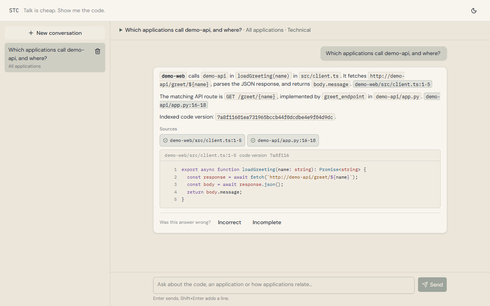
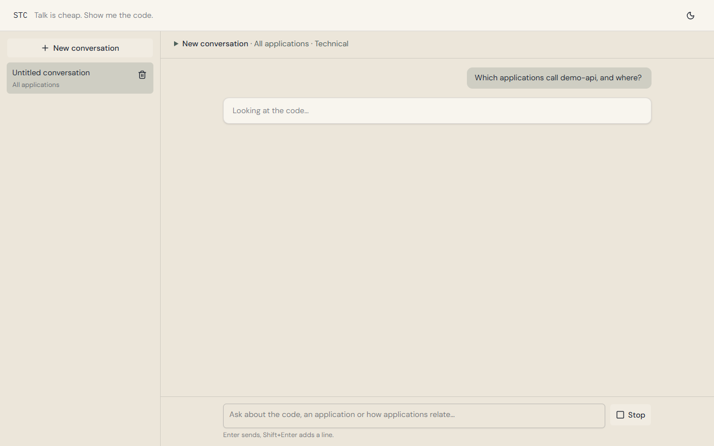
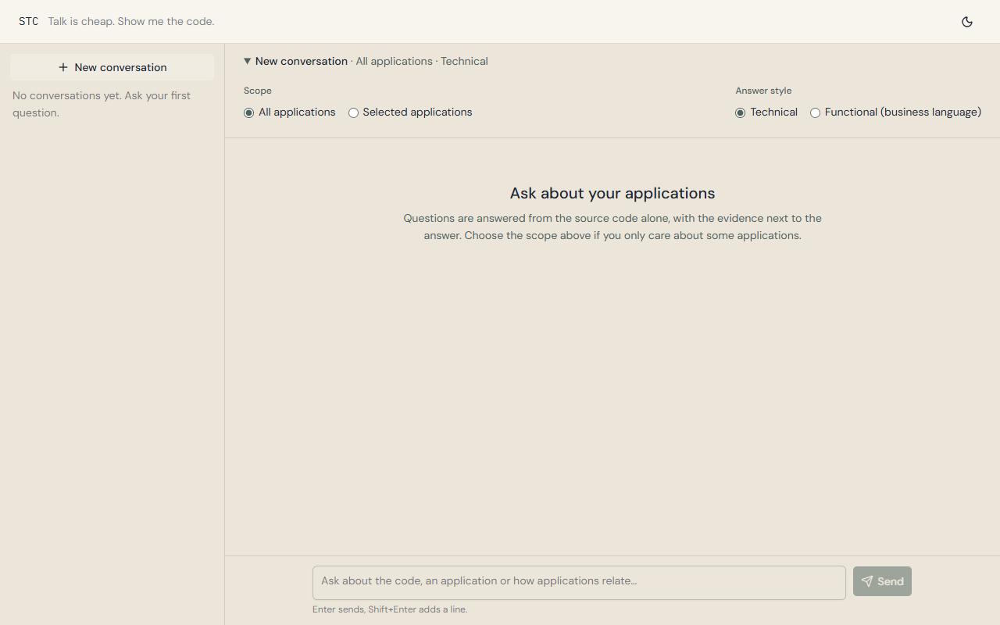

# STC

> *"Talk is cheap. Show me the code."* — Linus Torvalds

STC understands and answers questions about large collections of applications **that have no documentation**, using only their source code. Point it at folders or GitHub repositories with 100+ applications and ask things like *"which applications talk to the billing service?"* or *"where is this field validated?"*. Every answer comes with the evidence that backs it: application, file, line range and indexed code version.

The name is the philosophy: the system does not just talk, it shows the code.

## Status

**Working, pre-1.0** (see the [changelog](CHANGELOG.md)). The whole pipeline runs end to end: sources (local folders and GitHub), indexer, catalogs, global map, query engine, chat (API + web UI), MCP server, evaluation harness and operations commands (`sync`, `reindex`, `status`, Docker Compose). It has been exercised on the demo applications and on small real projects (TypeScript, Java/Spring Boot, React).

Not implemented yet: chat authentication (do not expose the chat beyond a trusted network), GitLab as a source, the Anthropic and Voyage providers (OpenAI is the one available), Gradle/Gemfile manifest detection, and extra sources in the Docker Compose setup (use the `stc` commands on your machine for those). The design is described in [docs/functional-spec.md](docs/functional-spec.md) and may still change.

## How it works

1. **Index.** The indexer walks read-only *sources* (local folders, and the repositories of a GitHub organization or user, which `stc sync` clones shallowly), detects the applications in them, strips secrets (and redacts credential values in configuration files), splits the code into meaningful units (functions, classes, modules) with tree-sitter, extracts signals (endpoints, outgoing calls, databases, messaging) and derives the relations between applications. Uncertain relations can be confirmed by the LLM. Indexing is incremental and idempotent.
2. **Catalog.** For each application it generates a human-readable, editable markdown **catalog** (purpose, stack, data model, endpoints, integrations, main flows, …), where every statement carries verified evidence and a confidence level, and gaps are listed instead of guessed. A **global map** shows how the applications relate to each other. Manual corrections survive regeneration.
3. **Query.** A single query engine searches catalogs and code (semantic + exact + symbol search), follows dependencies and reads files. It is exposed through:
   - a **chat** (web UI) that iterates over the engine until it has enough evidence, streams the answer, verifies every citation against the code and separates what is *proven in the code* from what is *inferred*;
   - an **MCP server**, so tools such as Claude Code, Claude Desktop or Cursor can query the same knowledge;
   - the `stc query` and `stc ask` commands.
4. **Evaluate.** `stc evaluate` runs a file of reference questions and reports search recall and answer quality, so changes to the indexer or the prompts can be measured.

Design principles:

- Facts (applications, symbols, relations, locations) come from deterministic analysis; the LLM interprets and always cites evidence.
- Application code is read-only: it is never modified or executed.
- Secrets are never indexed, sent to external services or returned in answers.
- Bring your own model provider: OpenAI first, Anthropic and others by configuration.

## Screenshots

The chat answering a question about the demo applications in `examples/demo-root/`: every claim carries a citation that was checked against the code, and clicking it shows the cited lines.

<picture>
  <source media="(prefers-color-scheme: dark)" srcset="docs/images/chat-answer-dark.png">
  
</picture>

While it works, the chat shows the steps it takes over the query engine; the scope and the answer style (technical or functional) are chosen per conversation.

<picture>
  <source media="(prefers-color-scheme: dark)" srcset="docs/images/chat-working-dark.png">
  
</picture>

<picture>
  <source media="(prefers-color-scheme: dark)" srcset="docs/images/chat-scope-dark.png">
  
</picture>

## Stack

Python 3.12+ (FastAPI, Typer CLI), PostgreSQL 17 + pgvector, tree-sitter, an MCP server, and an Angular + Tailwind + SpartanNG chat UI, shipped with Docker Compose. See [docs/tech-stack.md](docs/tech-stack.md).

## Quick start

Requirements: [uv](https://docs.astral.sh/uv/), Docker, and an OpenAI API key.

```bash
uv sync
docker run -d --name stc-dev-db -e POSTGRES_PASSWORD=test -e POSTGRES_DB=stc -p 55432:5432 pgvector/pgvector:pg17
cp .env.example .env          # set the database URLs, the models and your API key
uv run stc migrate-db
uv run stc index --root examples/demo-root
uv run stc catalog --all
uv run stc ask "which applications call demo-api, and where?"
```

To run everything in containers (database, API, MCP server and chat on port 8080):

```bash
docker compose up -d --build
```

### More than one folder, and GitHub

`STC_ROOT` is one folder. Declare more sources in a `sources.toml` next to your `.env`:

```toml
[[sources]]
name = "legacy"
path = "D:/code/legacy"

[[sources]]
name = "my-org"
type = "github"
owner = "my-org"          # an organization or a user
include = ["svc-*"]       # optional filters on the repository name
```

Put a read-only token (fine-grained, **Contents** and **Metadata**) in `.env` as `STC_GITHUB_TOKEN`, then:

```bash
uv run stc sync --dry-run             # what would be cloned or updated
uv run stc sync                       # clone or update (shallow, read-only)
uv run stc index --source my-org      # index one source (omit --source for all)
```

Every application remembers its source, and relations between applications of different sources are found as usual. The token only reaches `git` through its environment and is never logged. Details in [docs/getting-started.md](docs/getting-started.md).

The complete walk-through, including the chat UI, the MCP server and the evaluation, is in [docs/getting-started.md](docs/getting-started.md). `uv run stc --help` lists every command.

The demo applications in `examples/demo-root/` are fake and safe to send to a model provider. Before indexing your own code, read [docs/real-projects.md](docs/real-projects.md).

## Documentation

| Document | Contents |
|---|---|
| [docs/functional-spec.md](docs/functional-spec.md) | What the system does: requirements, acceptance criteria, open questions |
| [docs/tech-stack.md](docs/tech-stack.md) | Architecture, data model, indexing pipeline, AI providers, deployment |
| [docs/ui-spec.md](docs/ui-spec.md) | Global UI design system and patterns |
| [docs/getting-started.md](docs/getting-started.md) | Run the pipeline on the demo applications, step by step |
| [docs/real-projects.md](docs/real-projects.md) | Checklist for the first run on real code |

## Contributing

Issues and pull requests are welcome. Before opening a pull request, run the checks:

```bash
uv run pytest && uv run ruff check . && uv run ruff format --check . && uv run mypy
(cd frontend && npm test -- --no-watch)
```

Database tests are skipped unless `STC_TEST_DB_URL` points to a throwaway pgvector container (never the development database; see [CLAUDE.md](CLAUDE.md)). Requirements have IDs in the functional spec (IDX-*, CAT-*, QRY-*, CHT-*, MCP-*, XCT-*): cite them in issues and commits, and add user-visible changes to the "Unreleased" section of [CHANGELOG.md](CHANGELOG.md). See [CONTRIBUTING.md](CONTRIBUTING.md).

Everything in this repository (code, docs, commits, UI strings) is written in English. Catalogs generated from real code never belong here; keep them in their own private repository.

## License

[MIT](LICENSE) © 2026 Jorge Nascimento
