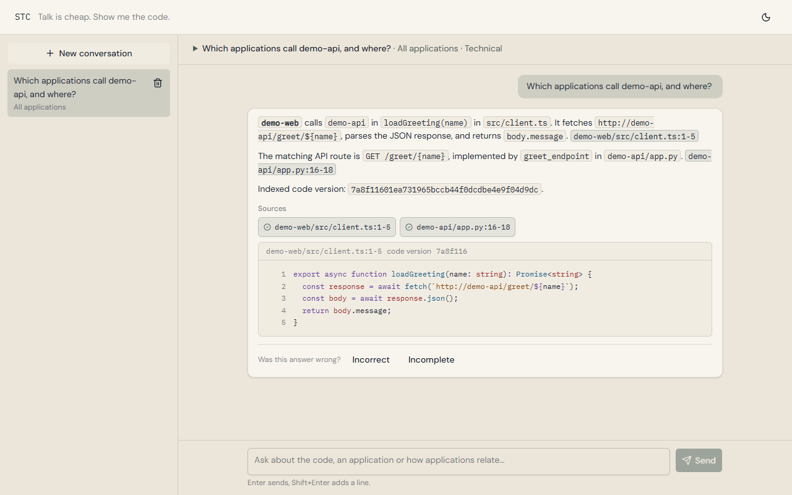
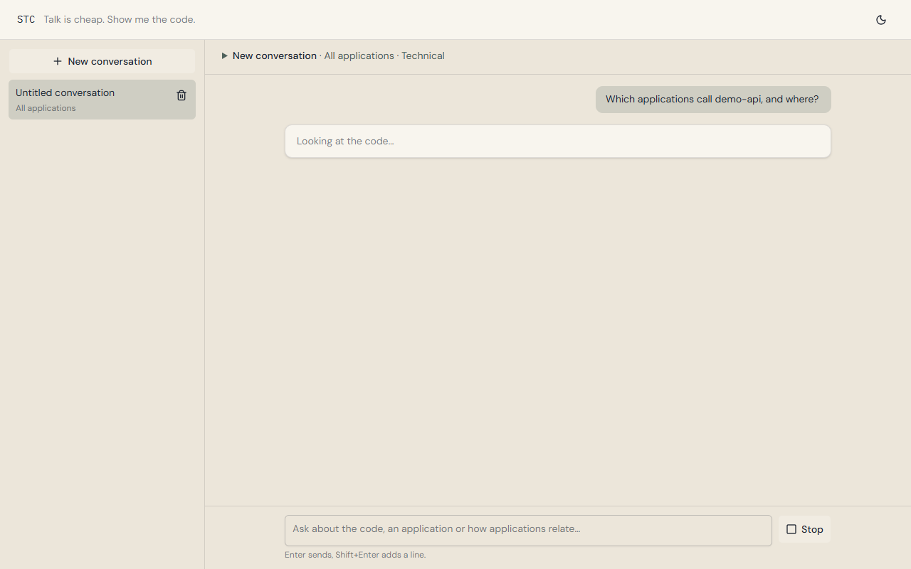
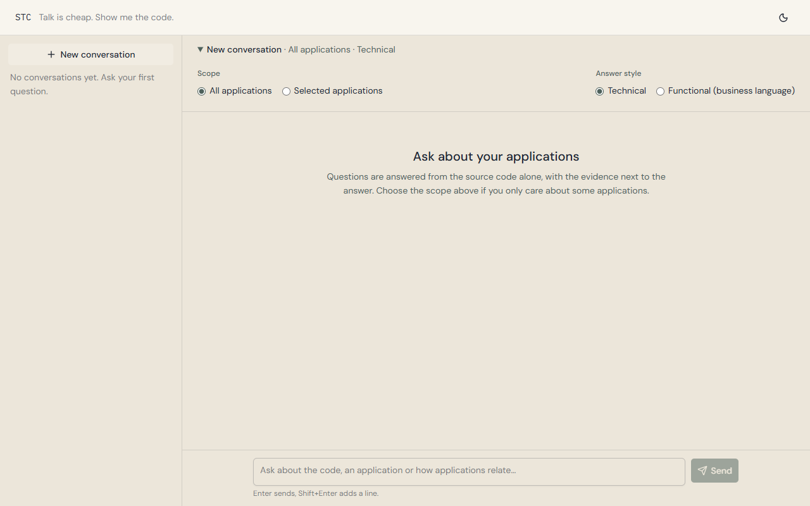
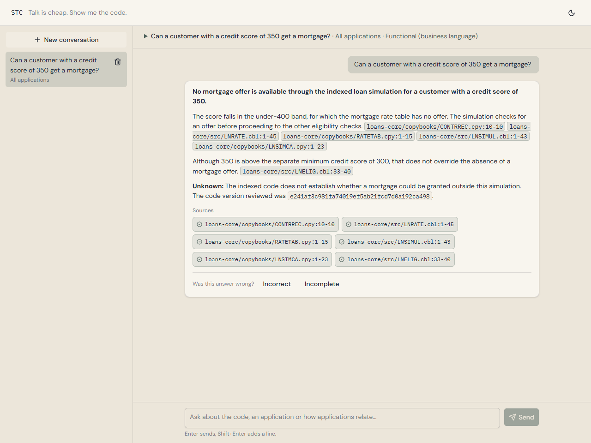
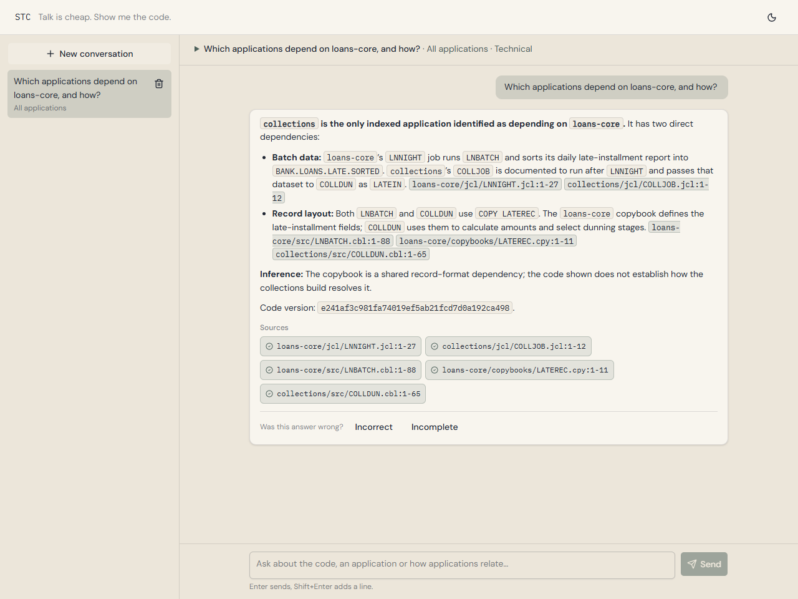
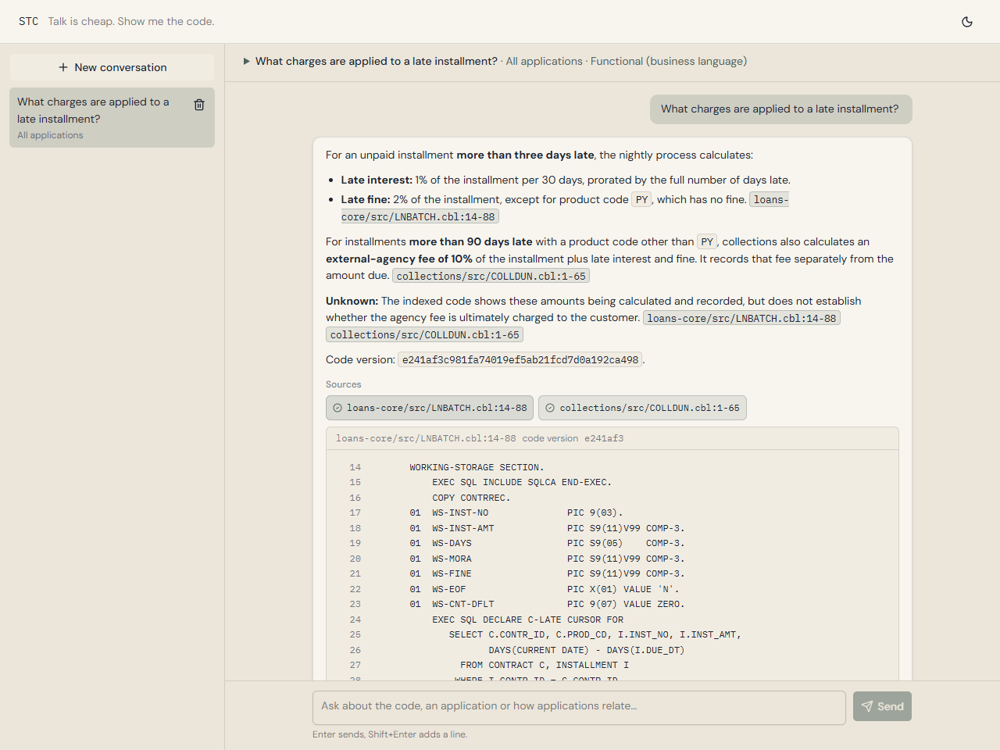

# STC

> *"Talk is cheap. Show me the code."* — Linus Torvalds

STC understands and answers questions about large collections of applications **that have no documentation**, using only their source code. Point it at folders or GitHub repositories with 100+ applications and ask things like *"which applications talk to the billing service?"* or *"where is this field validated?"*. Every answer comes with the evidence that backs it: application, file, line range and indexed code version.

The name is the philosophy: the system does not just talk, it shows the code.

## Status

**Working, pre-1.0** (see the [changelog](CHANGELOG.md)). The whole pipeline runs end to end: sources (local folders and GitHub), indexer, catalogs, global map, query engine, chat (API + web UI), MCP server, evaluation harness and operations commands (`sync`, `reindex`, `status`, Docker Compose). It has been exercised on the demo applications and on small real projects (TypeScript, Java/Spring Boot, React).

Not implemented yet: chat authentication (do not expose the chat beyond a trusted network), GitLab as a source, the Anthropic and Voyage providers (OpenAI is the one available), Gradle/Gemfile manifest detection, and extra sources in the Docker Compose setup (use the `stc` commands on your machine for those). The design is described in [docs/functional-spec.md](docs/functional-spec.md) and may still change.

## How it works

1. **Index.** The indexer walks read-only *sources* (local folders, and the repositories of a GitHub organization or user, which `stc sync` clones shallowly), detects the applications in them, strips secrets (and redacts credential values in configuration files), splits the code into meaningful units (functions, classes, modules) with tree-sitter, extracts signals (endpoints, outgoing calls, databases, messaging) and derives the relations between applications. Uncertain relations can be confirmed by the LLM. Indexing is incremental and idempotent.
2. **Catalog.** For each application it generates a human-readable, editable markdown **catalog** (purpose, stack, data model, endpoints, integrations, main flows, …), where every statement carries verified evidence and a confidence level, and gaps are listed instead of guessed. A **global map** shows how the applications relate to each other. Manual corrections survive regeneration.
3. **Query.** A single query engine searches catalogs and code (semantic + exact + symbol search), follows dependencies and reads files. It is exposed through:
   - a **chat** (web UI) that iterates over the engine until it has enough evidence, streams the answer, verifies every citation against the code and separates what is *proven in the code* from what is *inferred*;
   - an **MCP server**, so tools such as Claude Code, Claude Desktop or Cursor can query the same knowledge;
   - the `stc query` and `stc ask` commands.
4. **Document.** `stc docs` writes the full documentation of an application: linked markdown pages (overview, architecture, one page per feature, data model, interfaces, dependencies, configuration and operations) with Mermaid diagrams, viewable in the web UI under `/docs`. Tables and diagrams come from the index; the narrative is written by the LLM from assembled evidence and every statement is verified against the indexed code. See [Documentation and migration specifications](#documentation-and-migration-specifications).
5. **Specify.** `stc spec` writes, per feature, a migration specification (requirements, business rules, data, proposed design and implementation plan for a configurable target stack, acceptance scenarios, risks), meant for a coding assistant such as Claude Code to implement in a new project. STC does not generate the new code.
6. **Evaluate.** `stc evaluate` runs a file of reference questions and reports search recall and answer quality, so changes to the indexer or the prompts can be measured.

Design principles:

- Facts (applications, symbols, relations, locations) come from deterministic analysis; the LLM interprets and always cites evidence.
- Application code is read-only: it is never modified or executed.
- Secrets are never indexed, sent to external services or returned in answers.
- Bring your own model provider: OpenAI first, Anthropic and others by configuration.

## Screenshots

The chat answering a question about the demo applications in `examples/demo-root/`: every claim carries a citation that was checked against the code, and clicking it shows the cited lines.

<picture>
  <source media="(prefers-color-scheme: dark)" srcset="docs/images/chat-answer-dark.png">
  
</picture>

While it works, the chat shows the steps it takes over the query engine; the scope and the answer style (technical or functional) are chosen per conversation.

<picture>
  <source media="(prefers-color-scheme: dark)" srcset="docs/images/chat-working-dark.png">
  
</picture>

<picture>
  <source media="(prefers-color-scheme: dark)" srcset="docs/images/chat-scope-dark.png">
  
</picture>

### Searching COBOL programs

STC also reads COBOL, copybooks and JCL (no documentation needed). The screenshots below use the fictional bank in `examples/cobol-bank-root/` (a loans application and a collections application, with a nightly batch job, copybooks and DB2 tables). Business-rule questions can be answered in business language, with every citation checked against the indexed code.

A functional question: the answer finds the rate table (a copybook) and the program that reads it, and says what the code does not establish.

<picture>
  <source media="(prefers-color-scheme: dark)" srcset="docs/images/cobol-business-rule-dark.png">
  
</picture>

Relations between applications come from the code, not from guesses: the collections application depends on the loans application through a dataset written by one JCL job and read by another, and through a shared copybook.

<picture>
  <source media="(prefers-color-scheme: dark)" srcset="docs/images/cobol-dependencies-dark.png">
  
</picture>

Clicking a citation opens the cited COBOL lines, with the code version they were indexed from.

<picture>
  <source media="(prefers-color-scheme: dark)" srcset="docs/images/cobol-cited-code-dark.png">
  
</picture>

## Stack

Python 3.12+ (FastAPI, Typer CLI), PostgreSQL 17 + pgvector, tree-sitter, an MCP server, and an Angular + Tailwind + SpartanNG chat UI, shipped with Docker Compose. See [docs/tech-stack.md](docs/tech-stack.md).

## Quick start

Requirements: [uv](https://docs.astral.sh/uv/), Docker, and an OpenAI API key.

```bash
uv sync
docker run -d --name stc-dev-db -e POSTGRES_PASSWORD=test -e POSTGRES_DB=stc -p 55432:5432 pgvector/pgvector:pg17
cp .env.example .env          # set the database URLs, the models and your API key
uv run stc migrate-db
uv run stc index --root examples/demo-root
uv run stc catalog --all
uv run stc docs --all          # full documentation per application, shown in the chat UI under /docs
uv run stc spec --all          # one migration SPEC per feature (target stack configurable), for a coding assistant
uv run stc ask "which applications call demo-api, and where?"
```

To run everything in containers (database, API, MCP server and chat on port 8080):

```bash
docker compose up -d --build
```

### More than one folder, and GitHub

`STC_ROOT` is one folder. Declare more sources in a `sources.toml` next to your `.env`:

```toml
[[sources]]
name = "legacy"
path = "D:/code/legacy"

[[sources]]
name = "my-org"
type = "github"
owner = "my-org"          # an organization or a user
include = ["svc-*"]       # optional filters on the repository name
```

Put a read-only token (fine-grained, **Contents** and **Metadata**) in `.env` as `STC_GITHUB_TOKEN`, then:

```bash
uv run stc sync --dry-run             # what would be cloned or updated
uv run stc sync                       # clone or update (shallow, read-only)
uv run stc index --source my-org      # index one source (omit --source for all)
```

Every application remembers its source, and relations between applications of different sources are found as usual. The token only reaches `git` through its environment and is never logged. Details in [docs/getting-started.md](docs/getting-started.md).

The complete walk-through, including the chat UI, the MCP server and the evaluation, is in [docs/getting-started.md](docs/getting-started.md). `uv run stc --help` lists every command.

The demo applications in `examples/demo-root/` are fake and safe to send to a model provider. Before indexing your own code, read [docs/real-projects.md](docs/real-projects.md).

## Documentation and migration specifications

Both read the index and write plain markdown files, so they can be reviewed, edited and versioned. Corrections go between `<!-- stc:manual:begin ... -->` markers and survive regeneration. Pages are regenerated only when their inputs change; `--dry-run` shows the cost first and `--static-only` writes only what comes from static analysis, with no model call.

**Application documentation** (`stc docs <application>` or `--all`) writes `STC_DOCS/<application>/` (default `./appdocs`). Start the API and the frontend (`uv run uvicorn stc.api.app:app`, then `cd frontend && npm start`) and open **Documentation** in the header: page navigation, an outline, rendered diagrams, a link on every `file:start-end` citation that opens the code, and a download as a single markdown file.

**Migration specifications** (`stc spec <application>` or `--all`) writes `STC_SPECS/<application>/` (default `./specs`): an `index.md` with the target stack and the features in a migration order computed from their data dependencies, one `features/<feature>.md` per feature, and a `CLAUDE.md` to copy to the root of the new project. The target stack is free text, from a file given with `--stack` or `STC_SPEC_STACK`; the default is Java, Spring Boot, JPA, PostgreSQL and asynchronous REST.

To implement a specification in a new project with Claude Code:

1. Copy the contents of `specs/<application>/` to the root of the new project.
2. Connect the STC MCP server to that project (see [MCP server](#mcp-server)), so the assistant can read the cited legacy code with `read_file`; or copy the application folder into the project (for example `legacy/<application>/`).
3. Ask it to follow `CLAUDE.md` and implement the first feature of `index.md`. It works one feature at a time, turns the acceptance scenarios into tests, and asks about the gaps and low-confidence statements instead of guessing.

## Command reference

Run `uv run stc --help` or `uv run stc <command> --help` for the full text. Settings come from `.env`; `--env-file FILE` (also `STC_ENV_FILE`) before the command uses another file, for example `uv run stc --env-file .env.other status`. `--dry-run` shows what a command would do (and its estimated cost) without doing it. `--yes` skips the confirmation asked before a large embedding or generation run.

| Command | What it does | Options and arguments |
|---|---|---|
| `version` | Print the version | |
| `migrate-db` | Apply database migrations and set up the `stc_app` role | |
| `check-providers` | One tiny embeddings call and one tiny chat call, to verify keys and models | |
| `sync` | Clone or update the GitHub sources (shallow, read-only) | `--source NAME`, `--dry-run` |
| `detect` | List the detected applications (no database) | `--root DIR`, `--source NAME` |
| `index` | Detect, apply hygiene, register, chunk, derive relations and embed | `--root DIR`, `--source NAME`, `--dry-run`, `--prune` (remove applications no longer in the Root), `--skip-embeddings`, `--yes` |
| `reindex [APP]` | Reprocess one application, or all, even if unchanged | `--root DIR`, `--source NAME`, `--skip-embeddings`, `--yes` |
| `embed` | Embed chunks that have no vector yet | `--dry-run`, `--yes` |
| `relations` | List relations with confidence, evidence and LLM verdicts | `--root DIR`, `--refresh` (re-derive), `--confirm` (ask the LLM about uncertain ones), `--recheck`, `--dry-run`, `--yes` |
| `status [APP]` | What is indexed, what is pending, how the last runs went | `--check` (scan the Root for changes), `--root DIR`, `--source NAME` |
| `catalog APP` / `--all` | Generate catalogs and refresh the global map | `--all`, `--dry-run`, `--force`, `--yes` |
| `map` | Rebuild the global map from the index (no model) | |
| `docs APP` / `--all` | Generate the application documentation | `--all`, `--dry-run`, `--force`, `--static-only`, `--yes` |
| `spec APP` / `--all` | Generate the migration specifications | `--all`, `--stack FILE`, `--dry-run`, `--force`, `--static-only`, `--yes` |
| `ask "QUESTION"` | One question through the chat agent (not saved) | `--app NAME` (repeatable), `--profile technical\|functional` |
| `query ...` | Query the engine directly: `apps`, `catalog`, `map`, `deps`, `search`, `catalogs`, `grep`, `symbol`, `read`, `status` | `--json` |
| `corrections list\|approve\|reject` | Review catalog corrections proposed from the chat | |
| `evaluate` | Run the reference questions; report search recall and answer quality | `--questions FILE`, `--mode retrieval\|answers\|all`, `--id ID` (repeatable), `--k N`, `--baseline FILE\|latest\|none`, `--save/--no-save`, `--fail-under 0-1`, `--yes` |
| `serve-mcp` | Run the MCP server (read-only) | `--transport stdio\|http`, `--host`, `--port` |

Settings used by the generation commands (see `.env.example`): `STC_CATALOGS`, `STC_DOCS`, `STC_SPECS` (output folders), `STC_LLM_PROVIDER`, `STC_LLM_CATALOG_MODEL`, `STC_LLM_CHAT_MODEL`, `STC_LLM_DOCS_MODEL` (defaults to the catalog model), `STC_LANGUAGE`, `STC_DOCS_MAX_FEATURES` (default 15 feature pages), `STC_SPEC_MAX_FEATURES` (default 30) and `STC_SPEC_STACK`.

## MCP server

The MCP server exposes the query engine to tools such as Claude Code, Claude Desktop or Cursor. It is read-only; files that may contain secrets are never returned.

| Tool | What it does |
|---|---|
| `list_applications` | Indexed applications, with languages and whether a catalog exists. Filters: `name`, `technology`, `related_to`, `limit`, `offset` |
| `get_catalog` | An application's catalog, whole or by `sections`, with the evidence of each statement |
| `get_global_map` | How all applications relate, shared resources and technologies. The place to start for cross-application questions |
| `get_dependencies` | Direct and transitive dependencies of an application, with the code that proves each. `direction`, `max_depth`, `types` |
| `search_catalogs` | Search the catalogs (functional knowledge) by words |
| `search_code` | Search the code by meaning and by words together. Filters: `applications`, `languages`, `paths` |
| `grep_code` | Exact lines by literal text or regular expression (`pattern`, `regex`, `case_sensitive`) |
| `find_symbol` | Where a symbol is defined, and optionally used (`name`, `kind`, `exact`, `include_usages`) |
| `read_file` | A line range of an indexed file: `application`, `path`, `start_line`, `end_line` (at most 400 lines per call; follow `next_start_line`). `stale` is true when the file changed after indexing |
| `indexing_status` | What is indexed and how far the answers can be trusted |

Two transports:

- **stdio** (default), started by the client on the same machine. Needs `STC_DB_URL` in the environment or the settings file.
- **HTTP** for shared use: `uv run stc serve-mcp --transport http [--host H] [--port P]` listens on `STC_MCP_HOST`:`STC_MCP_PORT` (default `127.0.0.1:8765`, path `/mcp`) and requires `Authorization: Bearer <STC_MCP_TOKEN>`; without a token it refuses to start. `docker compose up` already runs it.

Connect Claude Code (use forward slashes in Windows paths; `-s user` makes it available in every folder):

```bash
claude mcp add -s user stc -- uv --directory /path/to/stc run stc --env-file .env serve-mcp
# or, against an HTTP server:
claude mcp add --transport http stc http://localhost:8765/mcp --header "Authorization: Bearer <STC_MCP_TOKEN>"
```

Connect Claude Desktop by adding the server to `claude_desktop_config.json` (Settings, Developer, Edit config), then restart the app completely:

```json
{
  "mcpServers": {
    "stc": {
      "command": "uv",
      "args": ["--directory", "/path/to/stc", "run", "stc", "--env-file", ".env", "serve-mcp"]
    }
  }
}
```

If the client cannot find `uv`, put its full path in `command`.

## Documentation

| Document | Contents |
|---|---|
| [docs/functional-spec.md](docs/functional-spec.md) | What the system does: requirements, acceptance criteria, open questions |
| [docs/tech-stack.md](docs/tech-stack.md) | Architecture, data model, indexing pipeline, AI providers, deployment |
| [docs/ui-spec.md](docs/ui-spec.md) | Global UI design system and patterns |
| [docs/getting-started.md](docs/getting-started.md) | Run the pipeline on the demo applications, step by step |
| [docs/real-projects.md](docs/real-projects.md) | Checklist for the first run on real code |

## Contributing

Issues and pull requests are welcome. Before opening a pull request, run the checks:

```bash
uv run pytest && uv run ruff check . && uv run ruff format --check . && uv run mypy
(cd frontend && npm test -- --no-watch)
```

Database tests are skipped unless `STC_TEST_DB_URL` points to a throwaway pgvector container (never the development database; see [CLAUDE.md](CLAUDE.md)). Requirements have IDs in the functional spec (IDX-*, CAT-*, QRY-*, CHT-*, MCP-*, XCT-*): cite them in issues and commits, and add user-visible changes to the "Unreleased" section of [CHANGELOG.md](CHANGELOG.md). See [CONTRIBUTING.md](CONTRIBUTING.md).

Everything in this repository (code, docs, commits, UI strings) is written in English. Catalogs generated from real code never belong here; keep them in their own private repository.

## License

[MIT](LICENSE) © 2026 Jorge Nascimento
